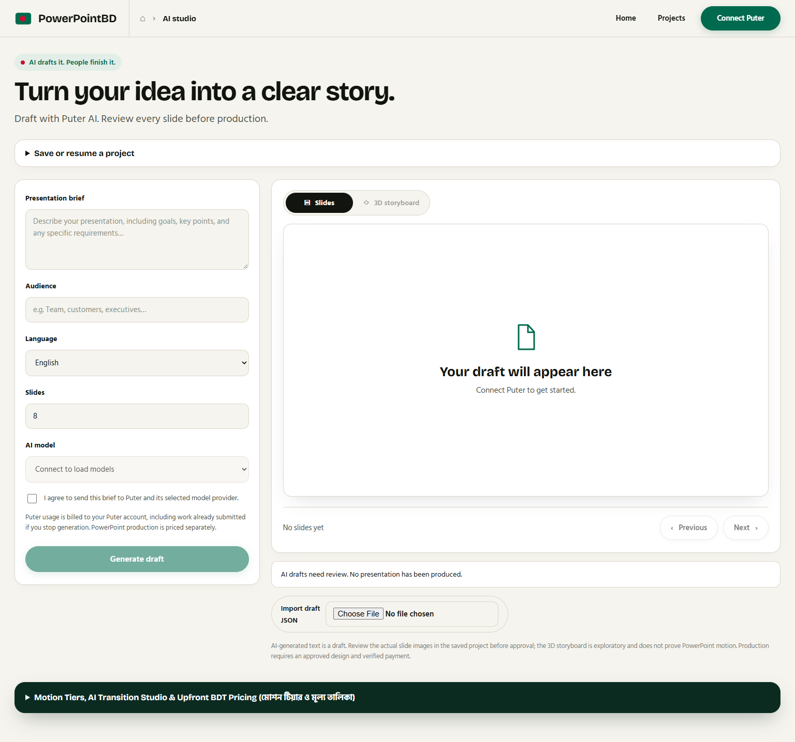
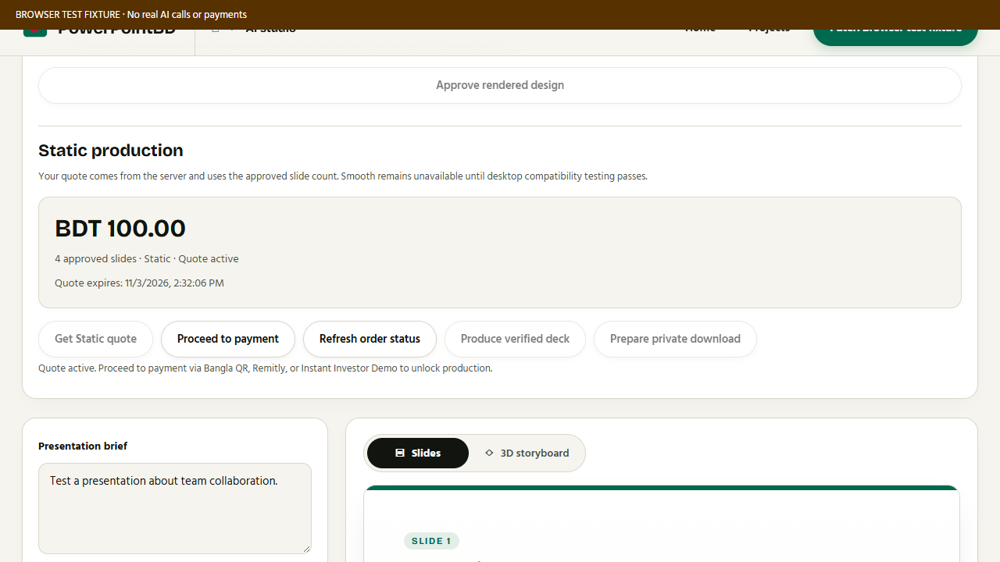

# PowerPointBD — Investor MVP Brief

**Prepared:** 26 October 2026  
**Product condition:** functional local MVP slice; conditional staging and paid launch.  
**Audience:** investor/product walkthrough and technical diligence.

## What the product does

PowerPointBD helps a user turn a presentation brief into editable slide content, save a versioned project, render and review the actual PowerPoint pages, explicitly approve a design, receive a server-calculated Static quote, and—after verified payment entitlement—queue production and download the private PowerPoint file.

The current workflow is a real product path with a local SQL/worker test environment. The product is **not yet a live commercial service**. Do not describe controlled browser fixtures or the mock payment sandbox as customers, live payment, or cloud acceptance.

## Investor walkthrough

1. Open `/studio.html`. The initial state is deliberately empty; no fabricated project, generation result, or order is preloaded.
2. Connect the user's Puter account, select a model discovered from its live catalogue, provide a brief, review consent, and generate editable slide text. Puter usage is billed to the user's Puter account. If Puter is unavailable or consent is absent, generation stays unavailable.
3. Edit slide titles, bullets and notes; inspect the optional 3D storyboard; export or import the draft JSON.
4. Sign in to the PowerPointBD project service on a configured authorized environment, save the versioned draft, render actual slide images, inspect every page and explicitly approve the current content version.
5. Request a server-side Static quote and explain that checkout is unavailable until a real provider has been selected and integrated.
6. In an authorized non-production demonstration environment only, show a pre-arranged verified sandbox order completing the queued worker path and private download. Label sandbox payment clearly. Do not create a customer-facing mock payment-success flow.

The browser screenshots under `artifacts/` are design/test evidence. The order and preview screenshots use controlled fixtures; label them as such if displayed.

### Walkthrough visuals

The first image shows the empty customer studio with no fabricated project or generated content. The second is a controlled browser fixture showing a four-slide Static quote; it demonstrates the quote and checkout-unavailable UI only, not a live payment or customer order.

## What is implemented and locally evidenced

- Studio UI with Puter catalogue discovery, consent, content validation, local editing, JSON import/export, reduced-motion handling and optional Three.js storyboard.
- Email/password account creation and sign-in, email-confirmation callbacks, and password recovery. Supabase PKCE links keep the verifier locally for at most 24 hours; access/refresh sessions remain in page memory.
- Authenticated, versioned draft APIs and database migration 0008.
- Durable real PPTX preview rendering to slide images, server-enforced preview/revision quotas, explicit approval, immutable approved content and source-bound Static quote/production inputs (migrations 0009–0011).
- PostgreSQL-backed production queue, separate worker, retry/fencing/quarantine behavior, independent content/package validation and private-storage interfaces.
- Server-authoritative order state, production entitlement checks, secure configuration guards, and investor-safe UI that keeps checkout unavailable without a real provider.
- Bounded authenticated API write limits for local/single-process deployments; hosted multi-replica deployments still need shared gateway enforcement.
- Release package build and local API/package smoke checks.
- Current-source cleanup removes the shared fixture password from browser demo and test source; a local source regression check passes. The existing live fixture credential still requires rotation by its authorized Supabase owner before any external demo.

Local verification: the latest disposable-PostgreSQL/process/security suite passed 49/49 after adding job-scoped recovery-claim coverage; the latest frontend suite passed 10/10 after removing the prefilled fixture credential; root TypeScript typecheck, frontend lint/build and isolated release smoke passed. Earlier recorded checks include the backend reference suite, optional real-renderer end-to-end suite (49/49 before the latest scoped-claim change), Python engine suite (33/33), Puter contract tests (7/7), rate-limit checks (2/2), browser suite (7/7, including email confirmation/reset fixtures), and zero production dependency advisories. The latest previously recorded warmed real-renderer journey passed on its first attempt in 40.1 seconds; a prior cold conversion exceeded the earlier 60-second bound and succeeded through the durable retry. These checks do not prove cold-start reliability, live Supabase Auth/email delivery/Storage, external TLS, provider payments, hosting, or desktop Office playback. The October 26 source-only security scan had partial source coverage and found the fixture credential before the current-working-tree cleanup; no live account or deployment checks were performed.

## What the conditions mean

| State | Meaning |
|---|---|
| Local MVP slice | Product code and isolated PostgreSQL/renderer path can be demonstrated locally with the configured dependencies. |
| Conditional staging | The authorized integration target is the dedicated `ai_presentation` schema in Supabase project `HTKIS---SaaS-Agency`. It requires reviewed migrations 0007–0011, migration 0011's restrictive private-Storage boundary, and live Auth/Storage/worker verification. The Supabase project also hosts unrelated applications, so testing must stay inside PowerPointBD's schema, bucket and scoped roles. |
| Paid launch | Also requires a selected and verified payment provider, commercial/refund/tax decisions, operational runbooks/monitoring/recovery, support ownership, and accepted customer journey. |
| Smooth tier | Not for sale until licensed desktop PowerPoint compatibility tests and genuine playback samples pass the agreed Windows/Mac/older-Office matrix. |

## Immediate completion sequence

1. Confirm the investor walkthrough environment and schedule a live demonstration using a safe isolated target.
2. Review and apply the local migrations to the confirmed `ai_presentation` target in order; test real authentication, storage transfer, worker completion and download without touching the other applications in that Supabase project.
3. Select the payment provider and commercial terms, then implement and verify its sandbox contract.
4. Verify signup/reset email delivery and callback allowlists on staging; complete accessibility, abuse controls, monitoring, retention and operational recovery acceptance.
5. Perform the desktop Smooth compatibility matrix and keep the tier disabled until evidence passes.
6. Re-run release checks against the final configured staging package; obtain release authorization before deployment or payment activation.

Ignored local configuration contains the existing Supabase integration credentials, but the repository does not include a production credential set or a live investor environment. The demo can be staged locally from the instructions in `README.md`; a remote investor demo requires the migration and live-verification conditions above.
